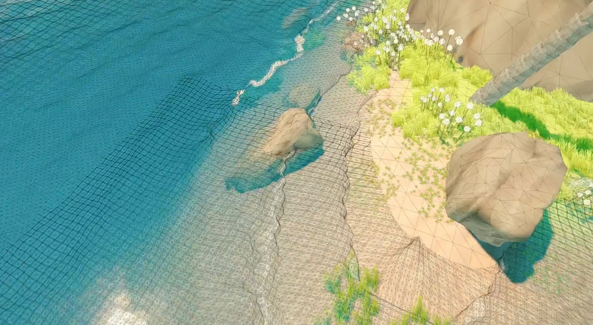
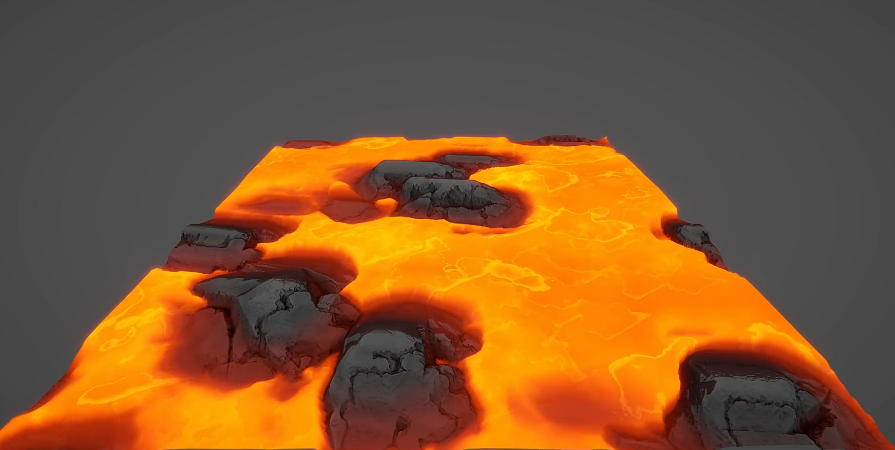

## Hi there 👋

<!--
**junyangtong/junyangtong** is a ✨ _special_ ✨ repository because its `README.md` (this file) appears on your GitHub profile.

Here are some ideas to get you started:

- 🔭 I’m currently working on ...
- 🌱 I’m currently learning ...
- 👯 I’m looking to collaborate on ...
- 🤔 I’m looking for help with ...
- 💬 Ask me about ...
- 📫 How to reach me: ...
- 😄 Pronouns: ...
- ⚡ Fun fact: ...
-->

My name is **junyangtong**, I am a Technical Artist Engineer currently living in Shanghai, China.

  

# Bartending Demo 

# Dynamic bone multithreading optimization 

# Toon Island Demo 
Water / Tod / Weather / Procedural Texture
<table><tr><td width="50%"></td><td width="50%"></td></tr></table>

# Black Island 
A puzzle game based on time and space transformation

# MagmaScene 
<table><tr><td width="50%"></td><td width="50%"></td></tr></table>
